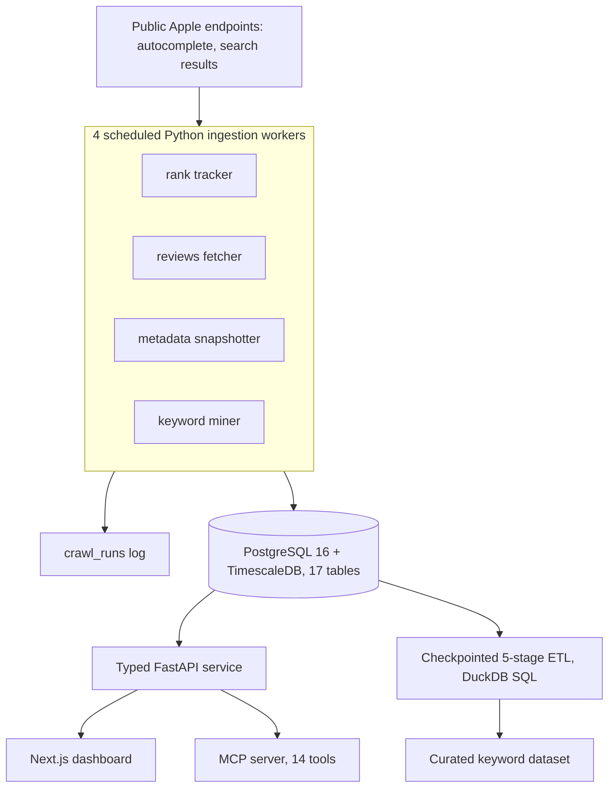

# Surfaced: App Store Analytics Data Platform

Surfaced is an iOS-first App Store Optimization (ASO) platform. It tracks where an app ranks for the keywords that matter, snapshots competitor metadata, reads reviews, and ranks keyword opportunities worth acting on.

**Status:** in development (runs locally with offline fixtures; no production scale is claimed).

> Source code is private. This repository is a README-only architecture write-up. Happy to walk through the code live: [adk08644@gmail.com](mailto:adk08644@gmail.com).

## Problem

Apple publishes almost no usable ASO data: no absolute search volume, no difficulty score, no ranking API. Everything has to be inferred from observed evidence. That drives the design: collect evidence continuously, store it as a time series, and keep scoring heuristics separate from, and versioned against, the evidence they read.

## Architecture

## Key engineering decisions

**Auditable ingestion.** Four scheduled workers (rank tracking, reviews, metadata snapshots, keyword mining) write time-series data to TimescaleDB. Every crawl is recorded in a `crawl_runs` row, so a partial or failed sweep is visible and can be re-run rather than silently missing.

**Time series with a safe fallback.** Rankings are stored as a TimescaleDB hypertable on capture time. The migration degrades to a plain PostgreSQL table if the extension is unavailable, so the stack still runs on a laptop.

**Versioned schema.** A 17-table schema evolves through numbered SQL migrations.

**Side-effect-free scoring.** The keyword scoring module has no database or network access, so the API, the workers and the tests run the same math. Observed evidence is kept apart from the small versioned heuristics that rank opportunities, and the model version is stamped on each result so a scoring change is attributable.

**Resumable ETL.** A checkpointed, resumable 5-stage pipeline over a keyword corpus (JSONL staging, deduplication, blocklist normalization) publishes a curated dataset through DuckDB SQL.

**Testable without the network.** pytest contract and parser tests run against offline fixtures, so the whole pipeline can be exercised without touching Apple.

**AI-agent access.** The same data is exposed to AI assistants through a 14-tool MCP server.

## Verified figures

| Item | Value |
|---|---|
| Scheduled ingestion workers | 4 |
| Schema | 17 tables, versioned SQL migrations |
| MCP tools | 14 |
| ETL | 5 stages, checkpointed and resumable |

## Tech stack

Python, FastAPI, SQLAlchemy, PostgreSQL 16 with TimescaleDB, DuckDB, SQLite (local fixtures), Next.js, Docker, pytest.
